# Box types

The box page offers nine enclosure types. The same list is available to a PA band, to a car subwoofer (except the big ones, see below) and, for the woofer slot, to a home speaker. Every type shows response, excursion, impedance, phase and group-delay plots, the level in the passband, the level at the amp power, and the highest steady level with the power at that limit. Chapter 6 of the [User Guide](User-Guide.pdf) covers each in depth.

## Sealed

One closed box. Reports fc, Qtc and F3; Qtc design buttons from the Loudspeaker Design Cookbook; fibre fill; box losses (QL, default 7).

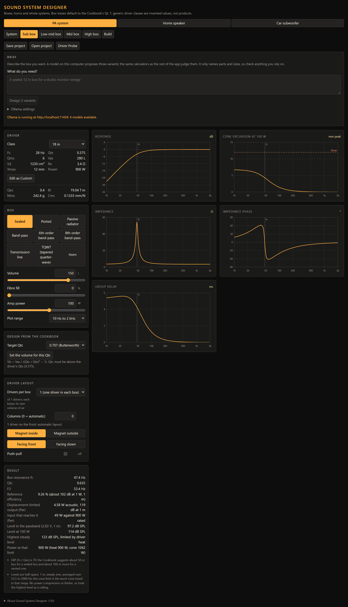

## Ported

Vented box with a tuning and a port (round or rectangular, horizontal or vertical). Cookbook alignments B4, BE4, QB3 and C4, vent length and port-area checks.

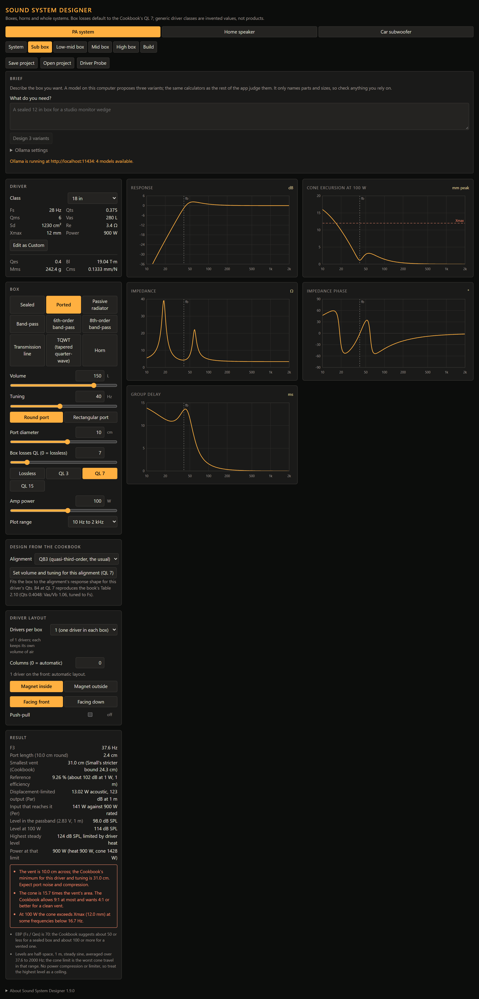

## Passive radiator

A second, undriven cone instead of a port; the mass to add is reported.

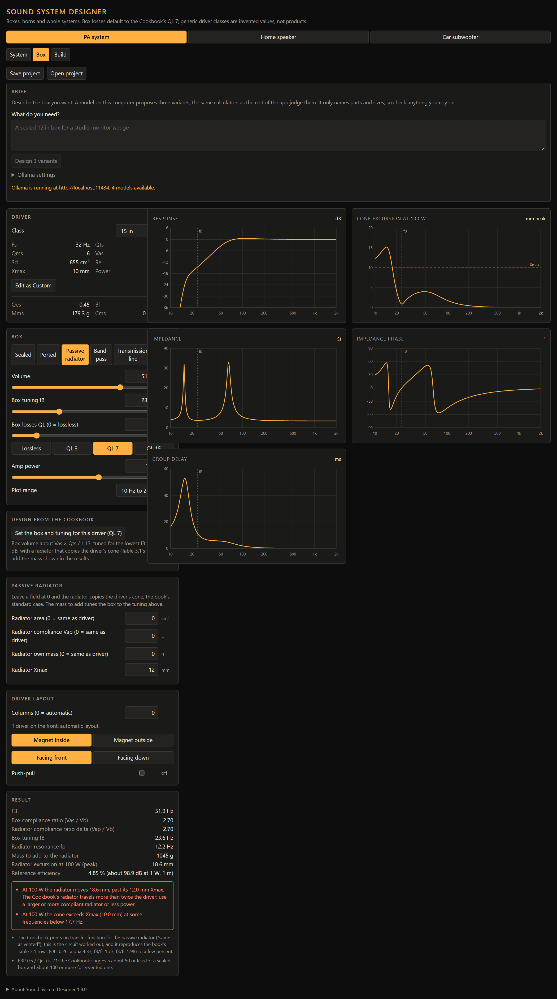

## Band-pass (4th order)

Sealed rear chamber, vented front chamber; peak level and passband reported.

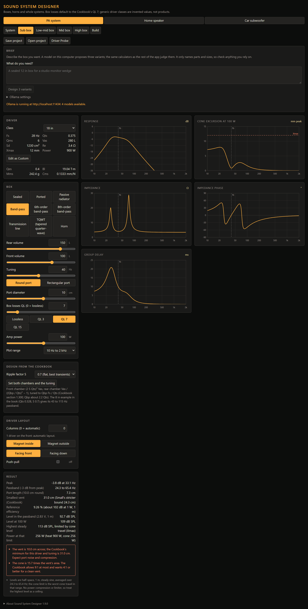

## 6th-order band-pass

A vented rear and a vented front chamber, with a design helper that finds chambers, tunings and ports for a passband you give it.

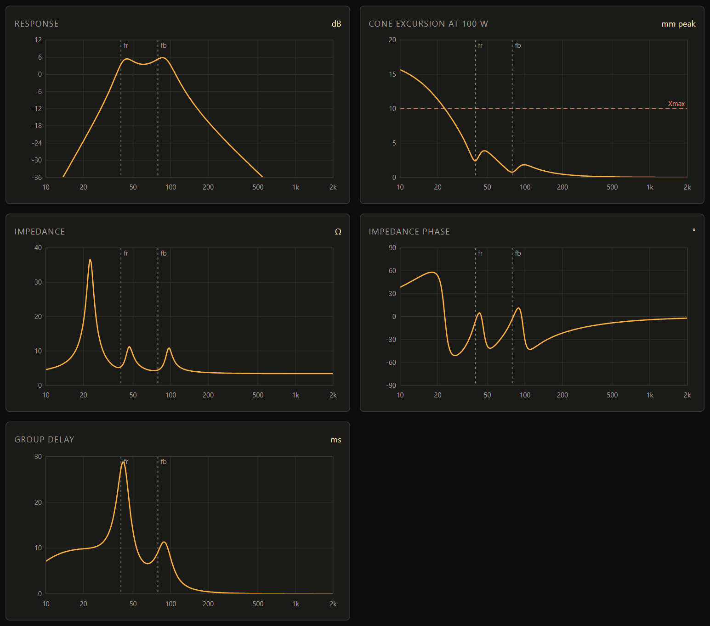

## 8th-order band-pass

Rear chamber vented to the room, vented into the front chamber, or sealed, with a front of two chambers in series. Same design helper.

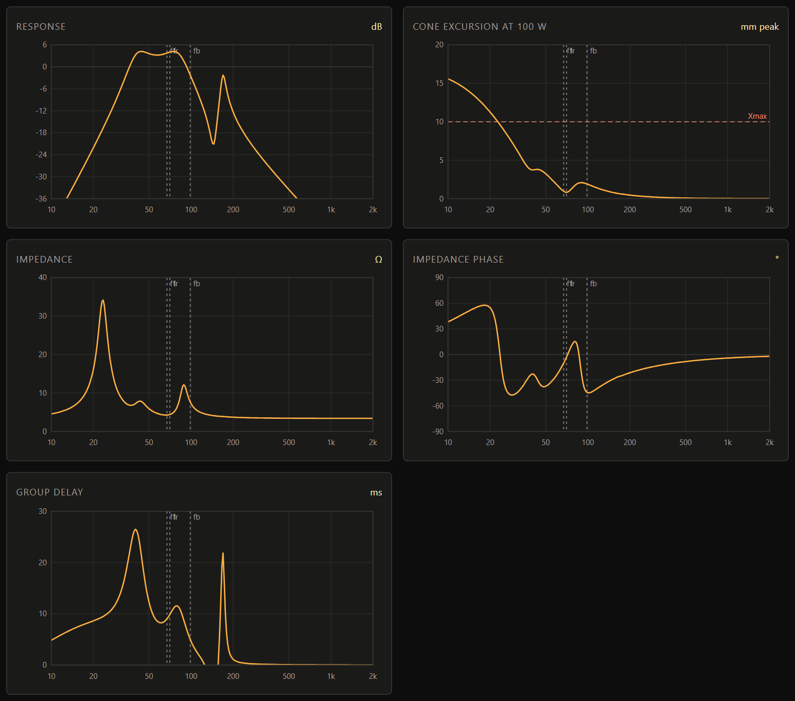

## Transmission line

A folded line, cut as one box with a chamber for the driver and a septum; the taper is a warning, not cut.

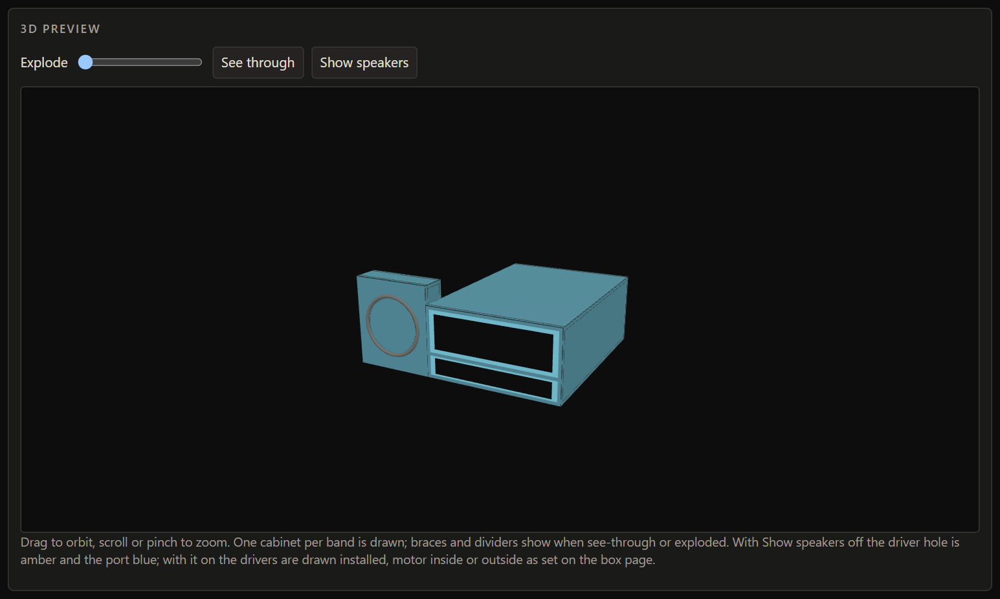

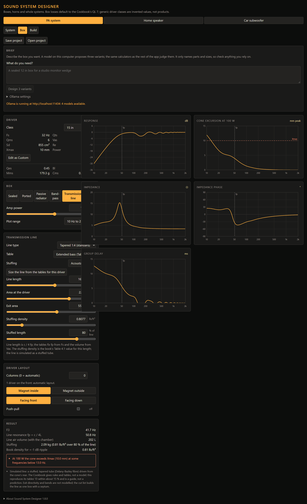

## TQWT (tapered quarter-wave tower)

A tapered column, cut as a tapered tower.

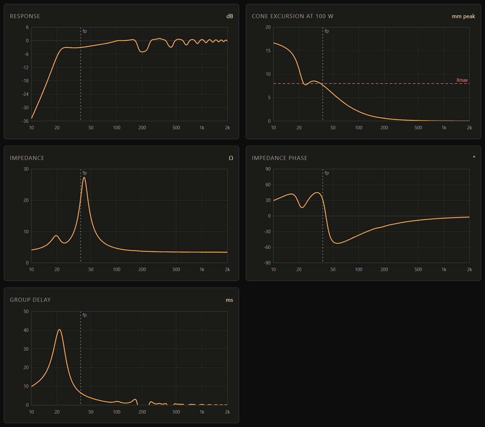

## Horn

A one-dimensional horn simulation: exponential, hyperbolic, tractrix or conical flare; front-loaded, or rear-loaded (the scoop). A horn can fold into one box of stacked legs, or, for the scoop, into tapered legs with sloped plates. When a fold does not work, the result list recommends settings that do.

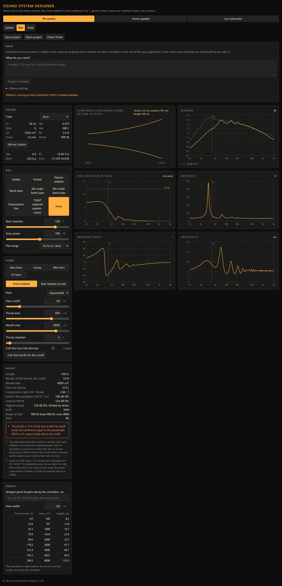

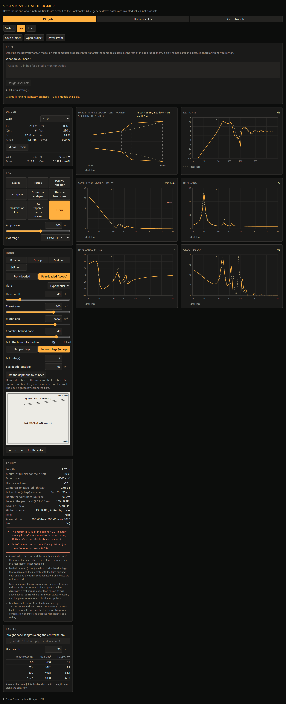

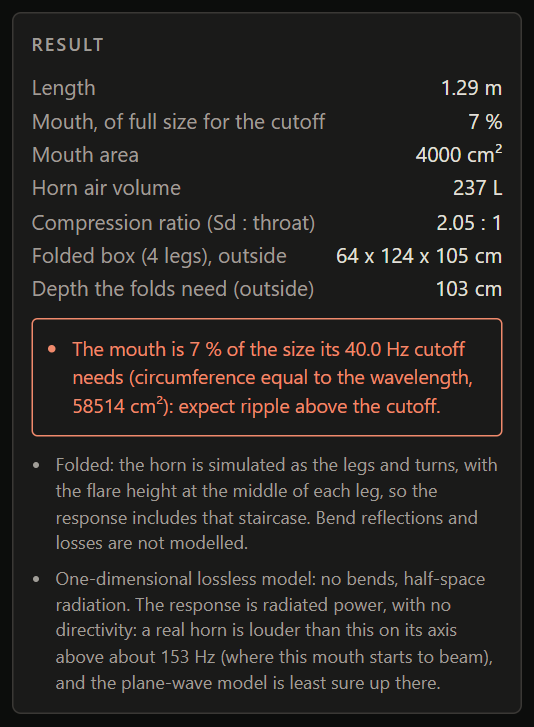

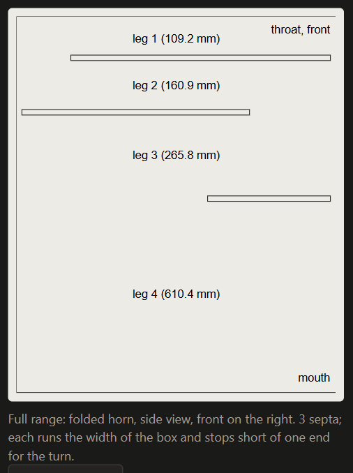

## What is and is not checked

- Sealed, ported, passive radiator, band-pass and horn: standard small-signal theory; the shared physics spec carries the closed-form test vectors and the app's tests assert every one.
- 6th-order, 8th-order and TQWT: the Cookbook has no equations for these. They are derived and checked against numeric solves of their circuits, not against a book (the app says so where they appear).
- The horn simulation is one-dimensional and lossless, half space only; the response is radiated power.
- A TQWT, a transmission line or a horn is too big for a car; the car page offers sealed, ported, passive radiator, band-pass and 6th- and 8th-order band-pass.
- Levels and limits are small-signal calculations, not measurements.
