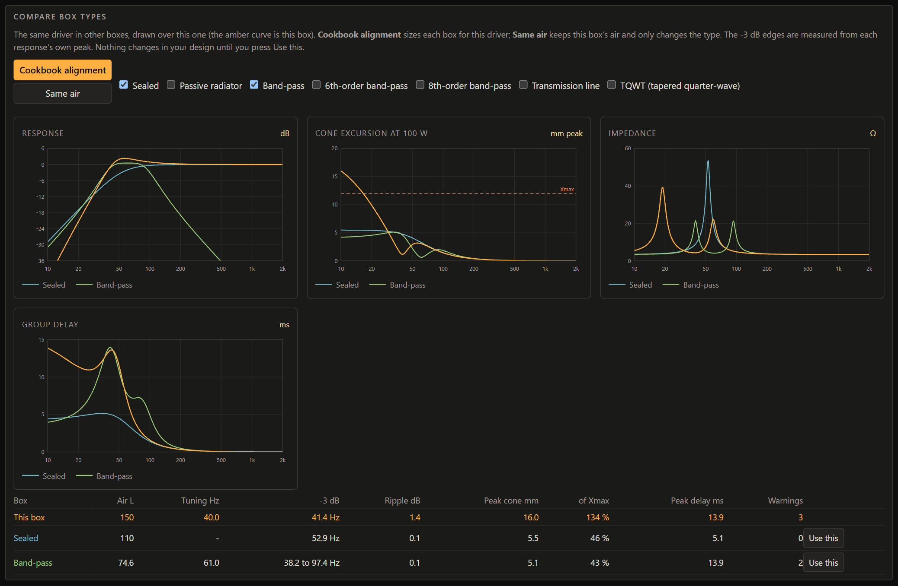
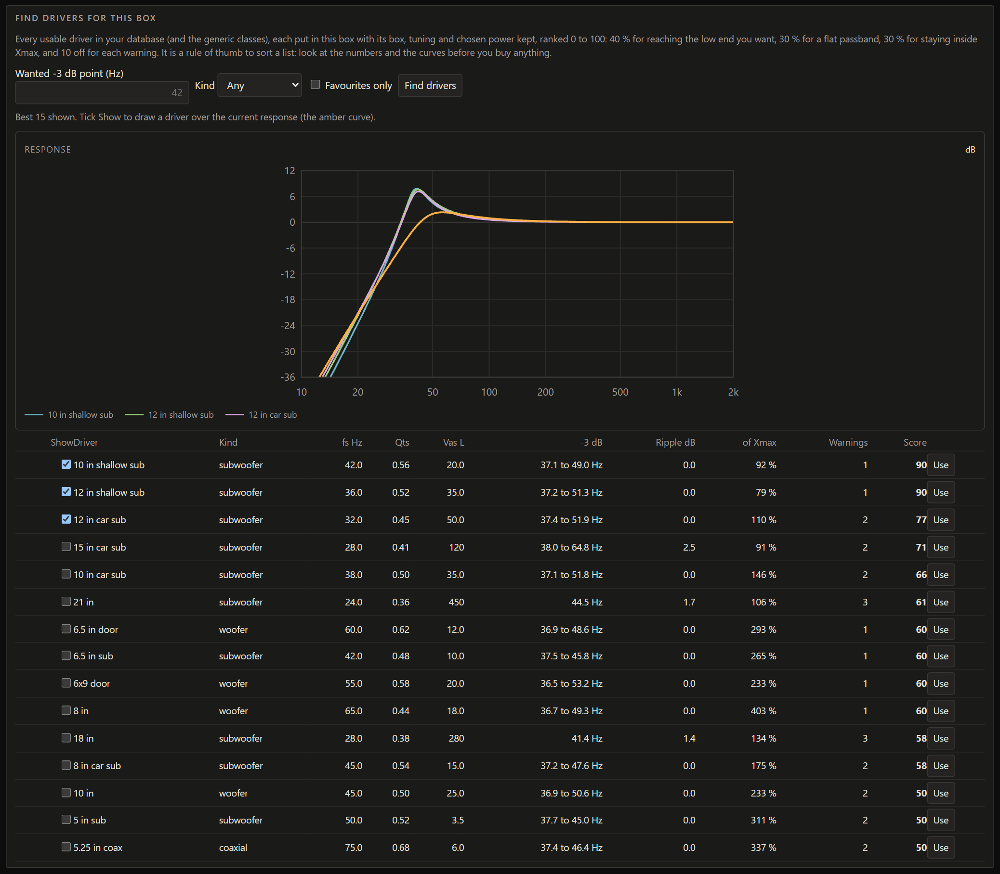

# Compare box types and find drivers for this box

Both panels are on the box page, under the plots (not for a horn).

## Compare box types

Tick one or more box types to draw the same driver in them over this box (the amber curve). **Cookbook alignment** sizes each for the driver the way the design buttons do: sealed for Qtc 0.707, ported on the QB3 alignment at QL 7 (a port that fits), the passive-radiator and band-pass designs, a line or TQWT sized from the driver. **Same air** keeps this box's air, tuning and port and only changes the type. A driver that cannot reach an alignment keeps its air and a note says so.

The table gives the air, the tuning, the -3 dB edges (measured from each response's own peak; a band-pass has two), the ripple (the peak above the middle of the passband), the peak cone excursion at the chosen power and as a share of Xmax, the peak group delay and the warnings. **Use this** makes a candidate the design and keeps the driver.

## Find drivers for this box

Press **Find drivers**: every usable driver of the database and the generic classes is put in this box and the best 15 are listed. Set the wanted -3 dB point (it starts at this box's own), a kind, and favourites only. The score, 0 to 100:

| Part | Weight | Full marks | None |
| --- | --- | --- | --- |
| Reaching the wanted low end | 40 % | -3 dB point at or below the target | twice the target |
| A flat passband | 30 % | up to 1 dB of ripple | 6 dB |
| Staying inside Xmax at the chosen power | 30 % | cone within Xmax | twice Xmax |

Ten points come off for each warning (at most 30). It is a rule of thumb to sort a long list, not a verdict: read the numbers and the curves. **Show** draws a driver over the current response; **Use** puts it in the box. If the box changes afterwards the list says so; press Find again.
