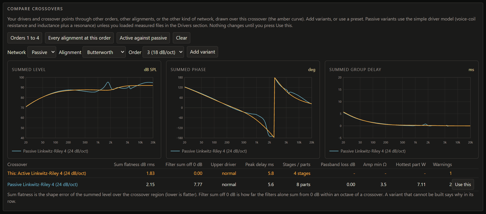

# Compare crossovers

On the Crossover page, under the plots, **Compare crossovers** runs your drivers and crossover points through other crossovers and draws them over the one on the page (the amber curve). A variant changes three things only:

- the **network**: active or passive;
- the **alignment**: Butterworth, Linkwitz-Riley, Bessel or Chebyshev;
- the **order**: 1 to 8, six dB per octave each. A passive network stops at 4, Linkwitz-Riley takes even orders, and an even-order Chebyshev cannot be passive; such a combination is refused with the reason.

Add up to four with **Add variant**, or use a preset: **Orders 1 to 4** (3rd against 4th and so on), **Every alignment at this order**, **Active against passive**.

The charts overlay the summed level, phase and group delay, and the impedance the amplifier sees when the crossover on the page is passive. The table gives, for each variant:

| Figure | Meaning |
| --- | --- |
| Sum flatness | the shape error of the summed level over the crossover region, dB rms (lower is flatter) |
| Filter sum off 0 dB | how far the filters alone sum from 0 dB within an octave of a crossover point |
| Upper driver | reversed or normal, as the polarity advice says |
| Peak delay | the peak of the summed group delay, ms |
| Stages / parts | filter stages (active, one op-amp each) or parts (passive) |
| Passband loss | how far a passive network sits below 0 dB in its passbands |
| Amp min | the lowest impedance the amplifier sees (passive) |
| Hottest part | the most heat in any part at the amplifier's full power (passive) |

**Use this** makes a variant the crossover on the page (the optimised passive values are kept only for the variant that was already there). Nothing changes until you press it.

An active and a passive crossover are compared on the same drivers, but a passive network is loaded by the driver's impedance (the simple model on the page, or a measured ZMA file) and an active one is not: load your measurement files first for the passive figures to mean much.
