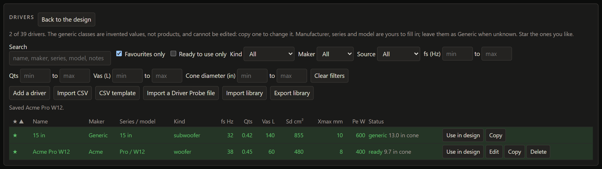

# The driver database

The **Drivers** button opens every driver the app knows: the generic classes (read-only, invented values) and your own. Your drivers stay on this computer; a project file carries its own copy of each driver it uses, so it opens anywhere.

- **Identity:** manufacturer, series and model are yours to enter; leave them as *Generic* when unknown. The name follows them unless you type one.
- **Numbers (datasheet units):** fs, Re, Qts, Qes, Qms, Vas, Sd, Xmax, Pe, and the extended Le, Mms, Cms, Bl, Rms, sensitivity, Znom and Xmech. fs, Re and two of the three Q values are required. The third Q, Vas and Cms, Mms, Bl and Rms are worked out when left empty. A number outside its range, or Qts, Qes and Qms that disagree by more than 10 %, is refused.
- **Ready to use** means Vas, Sd, Xmax and Pe are known. An incomplete driver (a Driver Probe record, say) is kept until you finish it.
- **Search and filters:** words (all must match name, maker, series, model, notes, kind), favourites, ready to use, kind, maker, source, ranges of fs, Qts, Vas and cone diameter. Sort by any column.
- **Favourites** are green and sort first; generic drivers can be starred too.
- **Use in design** puts the driver into a PA band, a home-speaker slot or the car subwoofer. The driver pickers on those pages list your favourites and your drivers beside the generic classes. A design keeps a copy; **Update from the library** re-copies it after an edit.
- **Import CSV** (one driver per row; the template has every column), **Import a Driver Probe file**, **Import library** and **Export library** (a `.ssd-drivers.json` file; a driver with the same manufacturer, series and model replaces the old one and keeps its favourite).

Not yet: the car page's front speakers still choose from the generic classes only.
