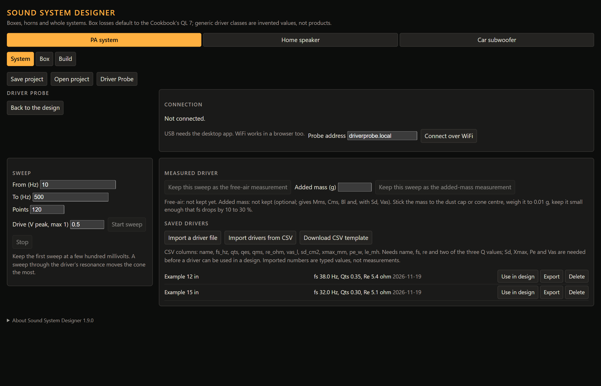

# Driver Probe and the driver library

The **Driver Probe** button in the header opens a page for measuring a real driver and keeping it for later designs.

## Measuring

The page talks to the Driver Probe rig (an ESP32 with an analog front end that sweeps a driver and streams its impedance) over **USB** (desktop app only) or **WiFi** (also in a browser; default address `driverprobe.local`). Set the sweep range, number of points and drive (keep the first sweep to a few hundred millivolts), and start. The impedance curve draws live with a running Thiele-Small fit: Re, Fs, Qms, Qes and Qts, each with a 95 % band.

A second sweep with a small mass stuck to the cone (the **added-mass method**) adds Mms, Cms, Bl and Vas. Sd, Xmax and Pe cannot come from a sweep and are typed in.

## Saving the driver

**Save to driver database** adds the record to the [driver database](driver-database.md), where you finish it (Sd, Xmax, Pe and Vas if a sweep could not give them), search it, star it and use it in a design. **Export file** writes a `.driver.json` record; the Drivers page reads one back.

A record whose bands are too wide is refused: measure again. A wrong number that looks exact is worse than none.
