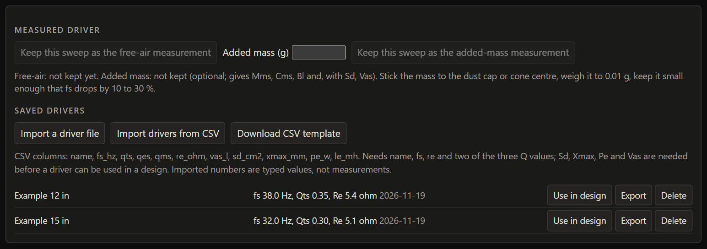

# Driver Probe and the driver library

The **Driver Probe** button in the header opens a page for measuring a real driver and keeping it for later designs.

## Measuring

The page talks to the Driver Probe rig (an ESP32 with an analog front end that sweeps a driver and streams its impedance) over **USB** (desktop app only) or **WiFi** (also in a browser; default address `driverprobe.local`). Set the sweep range, number of points and drive (keep the first sweep to a few hundred millivolts), and start. The impedance curve draws live with a running Thiele-Small fit: Re, Fs, Qms, Qes and Qts, each with a 95 % band.

A second sweep with a small mass stuck to the cone (the **added-mass method**) adds Mms, Cms, Bl and Vas. Sd, Xmax and Pe cannot come from a sweep and are typed in.

## The driver library

- Saved drivers live on your computer, one per name; saving a name again replaces it.
- **Export** writes a `.driver.json` record; **Import a driver file** reads one.
- **Use in design** makes the record the Custom driver of a PA box (it needs Sd, Xmax, Pe and Vas first).
- A record whose bands are too wide is refused: measure again. A wrong number that looks exact is worse than none.

## Datasheet drivers from a CSV

**Import drivers from CSV** reads a spreadsheet export (comma, semicolon or tab) with one driver per row. **Download CSV template** saves the columns:

`name, fs_hz, qts, qes, qms, re_ohm, vas_l, sd_cm2, xmax_mm, pe_w, le_mh`

A row needs a name, Fs, Re and two of the three Q values; the missing one is derived, and if all three are given they must agree within 10 %. Imported numbers are typed values with a band of 0, marked as datasheet records, not measurements.
