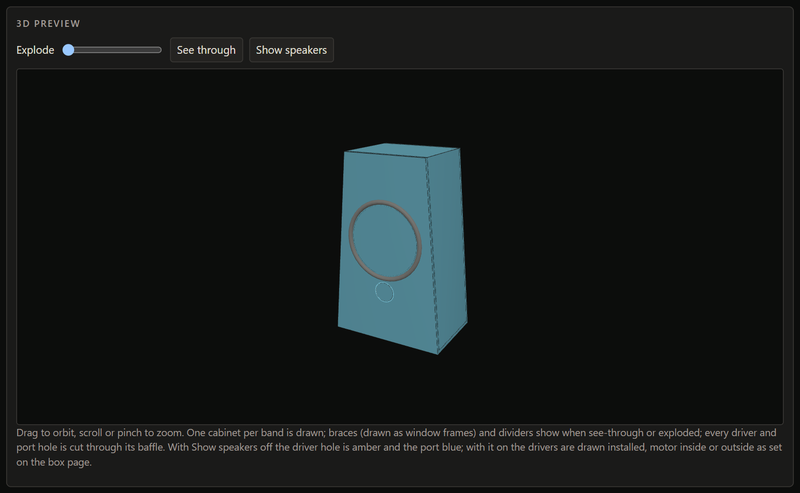
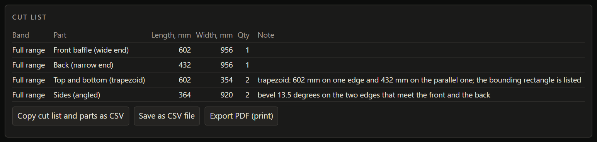

# Tapered boxes: trapezoid and tower

On the Build page each band of a PA system has a **Shape**:

- **Rectangular**: the box as before.
- **Trapezoid: wide front, narrow back**: the side walls angle in over the depth, like a stage monitor or a PA cabinet seen from above.
- **Tapered tower: wide bottom, narrow top**: the side walls lean in over the height.

**Narrow end over wide end** sets the taper: 1 is a plain box, 0.3 is very tapered. The interior proportions (width, height, depth) are for the wide end, and the air of the design is held exactly: a tapered box is bigger than the rectangle with the same proportions, because it has less volume per size.

## The cut list

- **Trapezoid:** a rectangular front (the wide end) and back (the narrow end), two trapezoid panels for the top and bottom, and two angled sides.
- **Tower:** a trapezoid front and back, a wide bottom, a narrow top and two leaning sides.
- Every angled side is cut to its **slant length** with its ends **bevelled** to the angle in the note. A trapezoid is listed by its bounding rectangle, and the note gives its two parallel edges.
- The **Baffles** section draws a tower's baffle as a trapezoid, and each trapezoid panel to scale with the length of every edge, with a download (SVG).
- The sizes are for butt joints. Test-fit the angled cuts before cutting every panel.

## What it applies to

Sealed, ported and passive-radiator boxes with one driver facing front in the default layout. A band-pass box, a horn, several drivers in a box, push-pull, columns or a baffle facing down is built rectangular, and a warning says why. Braces are built in as for a rectangular box (frames across the interior, evenly spaced from the front to the back; a plan trapezoid's are as wide as the interior where they sit, a tower's are trapezoids; the wood is taken out of the air). On a tower the baffle is narrow at the top: a hole that would come within the margin of the leaning wall at its upper edge is warned about.

The sheet layout (1.16.0) draws and exports a trapezoid panel with its true outline and lays two identical trapezoids head to tail, a kerf apart along their slanted edges, as one unit; the waste figure counts true areas. The angled sides of a trapezoid or tower box are plain rectangles (slant length by height or depth) with bevelled edges, so there is nothing to nest. From 1.18.0 the two sides of a car wedge box (right trapezoids, which pair into a rectangle) and the sides of a horn section whose ends differ (isosceles trapezoids, which pair head to tail) are nested the same way. The car page is not changed. The home speaker page has the same two shapes from 1.15.0: its baffle (the wide end) keeps the width and height set on the page and the depth follows from the air; it needs one column of drivers and a baffle facing front, otherwise it is built rectangular with a warning. Chamber partitions (1.17.0) lie flat where the air above them has run out: a trapezoid's partition is a trapezoid, a tower's a rectangle as wide as the interior at that height, so the shelf of a tower sits lower than the same share of the height. Their wood is taken out of the air, and the cut list gives their bevel. A port on the back wall is drawn on the narrow end of a trapezoid, or the trapezoid back of a tower; a port beside a driver is on the baffle as for a rectangular box.
